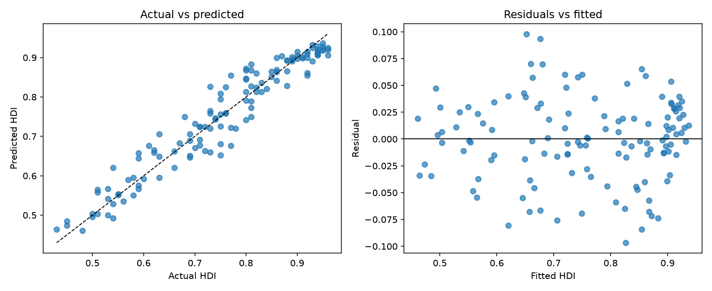

# Predicting the Human Development Index (HDI) with Python

I first built this multiple linear regression in Excel for a university unit (MIS171 Business Analytics, Deakin University). This repo rebuilds it in Python (pandas, statsmodels, scikit-learn) to check that both tools give the same answer, then adds checks that Excel did not provide: cross-validation, variance inflation factors and influence diagnostics.

Question: which country-level indicators help explain differences in the Human Development Index (HDI), and how well can they predict it?

## Data
The dataset (128 countries, 20 numeric indicators plus region and income group, with HDI as the target) was supplied by the unit for coursework, so it is not included in this repo. To run the script, place your copy at data/mis171_dataset_a3.csv. 

## Method
1. Convert Region and IncomeGroup to dummy variables (baselines: Central and Southern Asia, High income). This gives 29 candidate predictors.
2. Drop predictors with almost no correlation with HDI (|r| < 0.05): 5 dropped.
3. Drop one of each pair of highly correlated predictors (|r| > 0.70), keeping the one more correlated with HDI: 9 dropped, including GDP, GNI, expected and mean years of schooling, and internet use.
4. Fit OLS and remove the least significant predictor one at a time until all remaining predictors are significant at alpha = 0.10: 9 removed, leaving 6.
5. Check the final model with variance inflation factors, 5-fold cross-validation and Cook's distance.

Note: GNI and years of schooling are inputs to how HDI is calculated. They were candidates, but the multicollinearity step removed them, so none are in the final model.


## Results (n=128)
HDI = 0.987 - 0.536 x GII - 0.0013 x ParliamentFemale + 0.036 x Oceania - 0.032 x Sub-Saharan Africa - 0.128 x Low income - 0.057 x Lower-middle income

Measure	                        Excel (Data Analysis ToolPak)	      Python (statsmodels)
Final predictors	               the six above	                     identical
R-squared / adjusted R-squared	0.927 / 0.923	                     0.927 / 0.923
Overall F-test p-value	         2.9e-66	                           2.9e-66

Extra checks in Python:

5-fold cross-validated R-squared = 0.905 (RMSE 0.041), close to the in-sample 0.927.
All variance inflation factors are below 3.1 (highest: GII, 3.06).
Fiji and Tonga are the most influential countries (Cook's distance 0.28 and 0.23).



What the model suggests
1. Gender inequality (GII) is the strongest predictor: a 0.1 higher GII is associated with about 0.054 lower HDI, holding the other variables constant.
2. Low-income and lower-middle-income countries have HDI about 0.128 and 0.057 lower than high-income countries.
3. These are associations, not causal effects.


## Limitations
1. The Oceania coefficient rests on 5 countries and is mostly driven by Fiji and Tonga (p = 0.055), so it is a fragile result.
2. ParliamentFemale has a small negative coefficient. It overlaps with GII and region, so it should not be read as "more women in parliament lowers HDI".
3. For the scenario prediction, the point estimate matches Excel (0.830). The Excel confidence interval (0.824 to 0.836) used a simplified formula; statsmodels accounts for how unusual the scenario is and gives 0.820 to 0.840.
4. Cross-sectional data from a single year, with 128 countries and some countries omitted by the unit for missing data.

## Run it
```bash
python -m venv .venv
source .venv/bin/activate        # Windows: .venv\Scripts\activate
pip install -r requirements.txt
python analysis_mis171.py
```

## Next steps
- Compare with ridge/lasso and a random forest using cross-validation.
- Add Cook's distance to identify influential countries.
